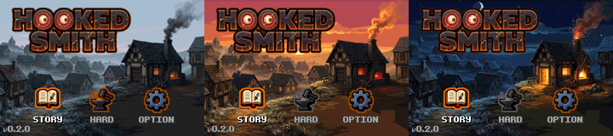
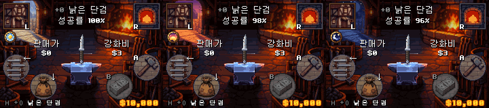

# Hooked Smith

세금에 시달리는 시골 대장장이 스미스가 낡은 단검을 **+29 검**까지 강화하는 GBA 게임입니다.
플래시 게임 「검 강화하기」의 강화 루프(강화 비용·확률, 실패 시 파괴, 판매가 주 수입, 깨짐 방지권, 잡템·화구 교환)를 GBA로 옮긴 **비공식 팬 게임**입니다.

> Unofficial fan game. Original concept © NBS.
> A fan-made Game Boy Advance game inspired by the Flash game "Sword Enhancing" (검 강화하기). Not affiliated with or endorsed by the original author or any platform holder.

## 화면

타이틀은 시계(카트리지 RTC)에 따라 **아침 / 노을 / 밤**으로 바뀝니다.



강화 화면도 같은 시간대를 따르고, 시간대마다 성공률 보정이 있습니다(왼쪽 위 L 아이콘 아래의 메달이 지금 시간대입니다).



## 특징

- 낡은 단검 +0 → **+29 검**까지 강화. 성공 연출은 단계별 4종, 실패·방지권 복구·+28 낚시 연출까지.
- 판매, 상점, 화구(잡템 조합), 창고, 잡화, 최고기록, 파산(게임 오버) 컷.
- 이벤트: 고양이(강화 실패가 쌓이면 찾아옴), 밤 도둑(창고의 높은 검이나 소지금을 훔침).
- 시간대(낮 06~16시 / 노을 16~21시 / 밤 21~06시)별 성공률 보정과 배경.
- STORY / HARD 모드(HARD는 엔딩을 보면 해금), 세이브 슬롯 3개, 레시피 화면.
- 오프닝 컷씬 7장면, 칩튠 효과음·배경음.
- +29 엔딩은 틀만 있습니다(시간대별 임시 문구 + HARD 해금 안내). 엔딩 그림·시나리오는 아직 없습니다.

## 조작 (강화 화면)

| 키 | 동작 |
|---|---|
| A | 강화 |
| B | 판매 |
| L | 상점 |
| R | 화구 |
| ← | 창고 |
| ↓ | 잡화 |
| START | 일시정지 메뉴 |
| SELECT | 도움말 (이 상태에서 START = 레시피) |

## 빌드

요구 사항: [devkitARM](https://devkitpro.org/), [Butano 21.8.0](https://github.com/GValiente/butano), Python 3 + Pillow.

```
# 일반 + 디버그 ROM 동시 빌드 (Windows)
tools\build_both.bat
```

결과로 `hookedsmith.gba`(일반)와 `hookedsmith_debug.gba`(디버그)가 생깁니다. 디버그 ROM은 HARD가 열려 있고 돈·재료 지급, 단계 점프, 시간대 강제 등 확인용 키가 있습니다. 자세한 환경 설정과 주의 사항은 [CLAUDE.md](CLAUDE.md)를 보세요.

에뮬레이터는 mGBA에서 확인했습니다. 시간대 기능은 카트리지 RTC를 쓰므로 mGBA에서 RTC를 켜야 낮 외의 시간대를 볼 수 있습니다.

## 문서

| 문서 | 내용 |
|---|---|
| [docs/GAME_MANUAL.md](docs/GAME_MANUAL.md) | 구현된 시스템 전체 매뉴얼 (규칙, 확률 표, 화면, 연출) |
| [docs/ECONOMY_SPEC.md](docs/ECONOMY_SPEC.md) | 원작 수치와 경제 규칙 |
| [docs/DESIGN_NOTES.md](docs/DESIGN_NOTES.md) | 용어, 스토리, 데이터 취급 원칙 |
| [CHANGELOG.md](CHANGELOG.md) | 버전별 변경 이력 |
| [CLAUDE.md](CLAUDE.md) | 개발 핸드오프 (환경, 빌드, 코드 지도, 주의 사항) |

## 크레딧

- 엔진: [Butano](https://github.com/GValiente/butano) (Gustavo Valiente)
- 원작 컨셉: 「검 강화하기」 © NBS
- 제작: Jay's Loft
- 그림은 AI 생성 일러스트를 GBA 해상도와 팔레트로 가공한 것이고, 효과음과 강화 화면 배경음은 코드로 합성했습니다.

## 라이선스

아직 정하지 않았습니다.
